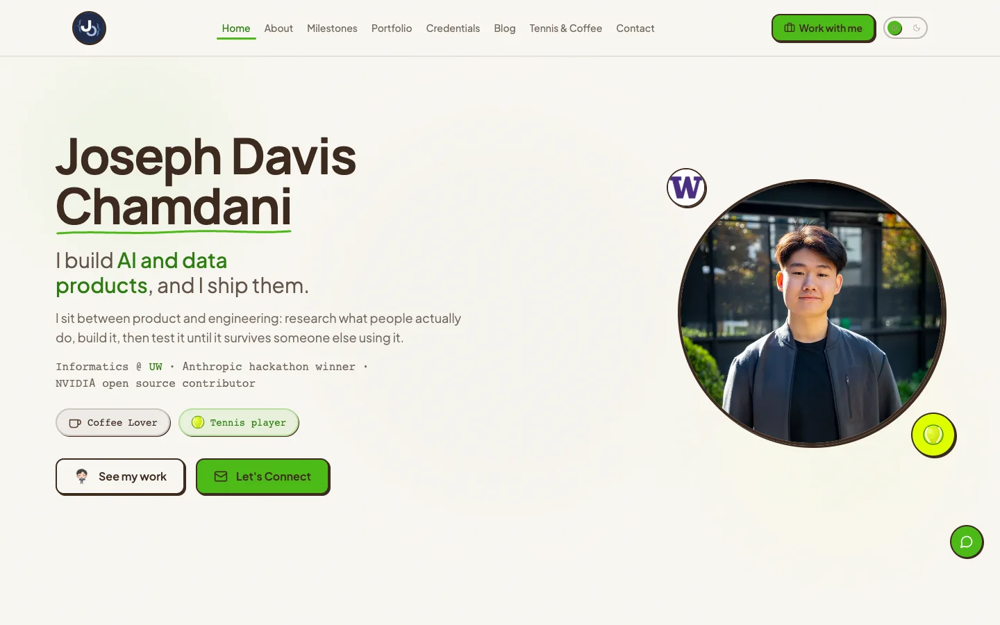
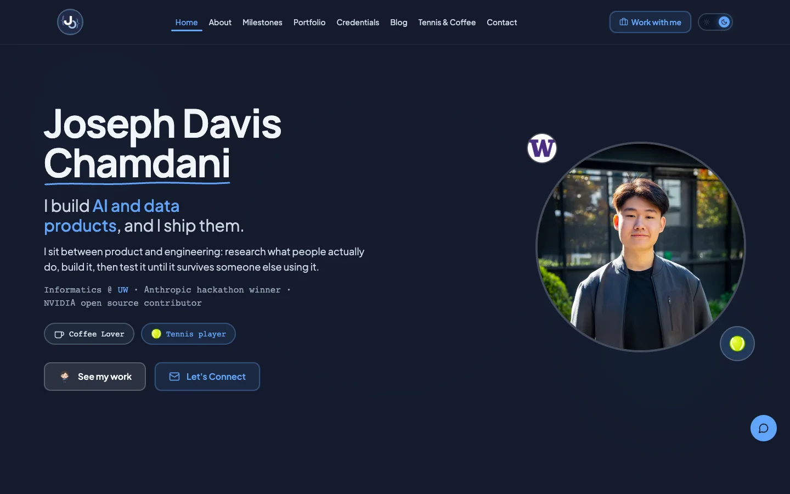
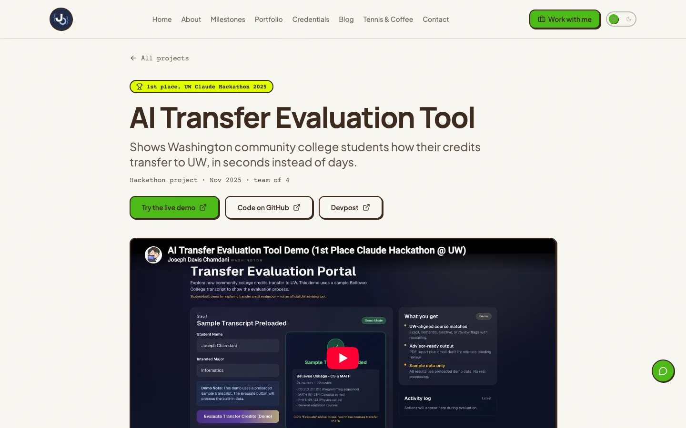
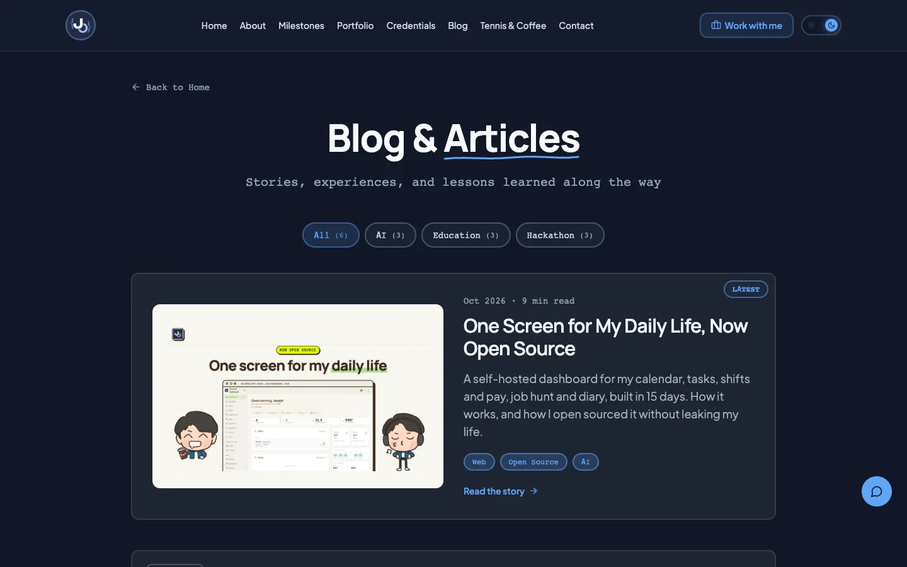
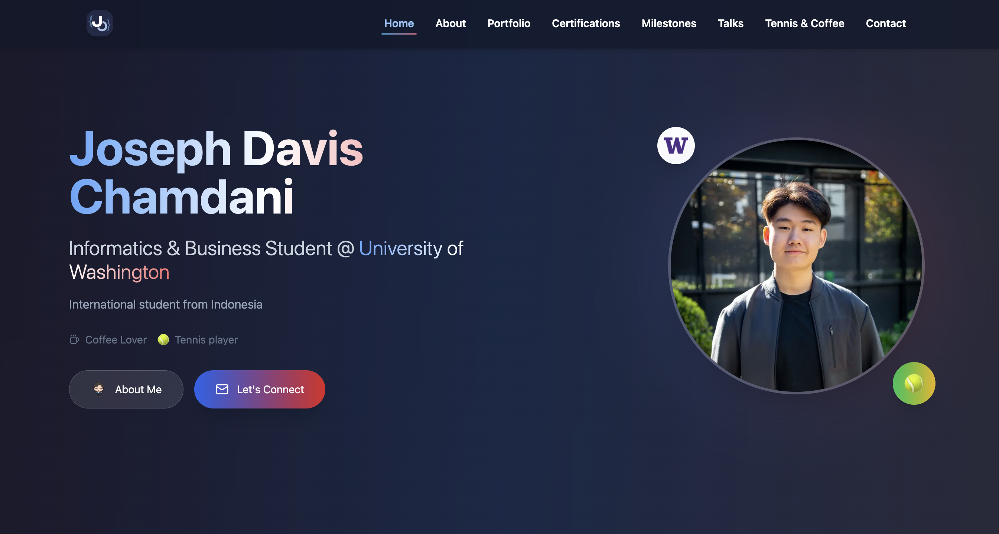

<a href="https://joechamdani.com" target="_blank">
  
</a>

# Joseph Davis Chamdani · Portfolio v2.2

[](https://joechamdani.com)
[](https://github.com/JosephDavisC/Portfolio-Website/releases/tag/v2.2.0)

---

## About

This is my personal **portfolio website**, where I showcase my background, projects, experience, writing and certifications.

It follows my path as an **Informatics student at the University of Washington**, with personal touches like my love for tennis and coffee.

Live site: **[joechamdani.com](https://joechamdani.com)**



---

## What's new in v2.2

- **Project case studies.** [`/projects/transfer-tool`](https://joechamdani.com/projects/transfer-tool/) walks through the AI Transfer Evaluation Tool like a product interview answer: the problem, who it's for, the alternatives (with sources), the solution and what it produces. The team photo has a hover and tap "who's who". Case studies are data-driven, so the next one is a JSON entry, not new code.
- **A real blog.** A `/blog` index with an RSS feed, editorial cards, and articles with images that open full size.
- **An experience page.** `/experience` has the full timeline, with a detail page for each internship, including photos and recommendations.
- **WCAG AA contrast in light mode.** Buttons, links and muted text were retuned. Contrast failures dropped from 247 to 84 across seven pages, without changing the palette.
- **Built for search engines and AI readers.** Every page is prerendered with real content, canonical URLs and structured data, and an `llms.txt` gives AI assistants an accurate map of the site.

Full notes: [v2.2.0 release](https://github.com/JosephDavisC/Portfolio-Website/releases/tag/v2.2.0). Changes are made through documented pull requests with before and after screenshots, for example [#2](https://github.com/JosephDavisC/Portfolio-Website/pull/2) and [#3](https://github.com/JosephDavisC/Portfolio-Website/pull/3).

---

## Design

The v2 redesign moved away from generic dark templates toward a **tactile, paper-textured, neobrutalist** look that reflects who I am.

- **Organic palette.** The colors come from two of my passions: **tennis** (Court Green `#4CBB17`) and **coffee** (Espresso `#3D2B1F`).
- **Custom interactions.** Tennis ball particles, animated coffee steam and hand-built micro-interactions, all purpose-made.
- **Two themes.** A warm light mode with paper textures and offset shadows, and a dark mode with glassmorphism and neon blue accents. Both switch with a smooth 500ms fade.
- **Neobrutalist details.** Cards with offset shadows, hand-drawn scribble underlines and playful hover states that make the interface feel tangible.



---

## Features

- **Homepage sections:** hero, about, milestones, portfolio, certifications, awards, blog, tennis and coffee, recommendations, contact
- **Projects page** with category filters (AI, Web, Games, Data), plus case study pages
- **Blog** with article pages, an RSS feed and click-to-enlarge images
- **Experience timeline** with a detail page per role
- **Credential pages** for each certificate
- **Contact form** with a custom PHP backend and an auto-reply
- **SEO:** prerendered pages, Open Graph images for LinkedIn, Facebook, X and WhatsApp, a sitemap with image entries, and JSON-LD
- **Accessibility:** AA contrast in light mode, keyboard focus states and reduced-motion support
- **Responsive** on every screen size, with easter eggs hidden throughout

| Case study | Blog |
|---|---|
|  |  |

---

## Tech Stack

- **React + TypeScript**: frontend
- **Vite**: build tool
- **Tailwind CSS**: styling
- **Framer Motion**: animations
- **React Router**: client-side routing
- **React Helmet Async**: per-page meta tags
- **Lucide React**: icons
- **Hostinger**: hosting

---

## Project Structure

```
src/
 ├── components/
 │    ├── sections/        # Homepage sections (Hero, About, Milestones, Portfolio,
 │    │                    #   Certifications, Awards, Blog, TennisCoffee, Testimonials,
 │    │                    #   Contact) and the shared image Lightbox
 │    └── shared/          # Navbar, Footer, ContactForm, ThemeToggle, OptimizedImage, ...
 ├── contexts/             # ThemeContext (light and dark)
 ├── data/                 # Content lives here as JSON
 │    ├── projects.json         # Project cards
 │    ├── projectPages.json     # Case study pages
 │    ├── articles.json         # Blog posts
 │    ├── experiences.json      # Experience detail pages
 │    ├── milestones.json       # Timeline
 │    └── credentials.json      # Certificates
 └── pages/                # Index, ProjectsPage, ProjectPage, BlogPage, ArticlePage,
                           #   ExperiencePage, InternshipPage, CredentialPage, NotFound

public/                    # Images (with .webp twins), article media, logos, sitemap, llms.txt

scripts/
 ├── generate-static-pages.js   # Prerenders pages with real content and meta tags
 ├── generate-blog-meta.js      # Prerenders blog articles, builds RSS
 ├── check-webp-twins.js        # Build guard: every image has a .webp twin
 └── check-content-rules.js     # Build guard: share images, media paths, sitemap images
```

Most content changes are a JSON edit. The build guards fail the build on mistakes that would otherwise only show up in production, such as a share image LinkedIn can't render or a sitemap image that doesn't exist.

---

## Setup

```bash
git clone https://github.com/JosephDavisC/Portfolio-Website.git
cd Portfolio-Website
npm install
npm run dev      # local dev server
npm run build    # production build, prerendering and build guards
```

---

## Version history

- **v2.2** (Oct 2026): case studies, the blog and experience pages, AA contrast, and prerendering for search and AI readers
- **v2.1** (Aug 2026): awards, testimonials, a performance pass and `llms.txt`
- **v2.0** (Jan 2026): the paper-textured neobrutalist redesign
- **v1.0** (Nov 2025): the original dark glassmorphism design

The v1.0 look lives on in today's dark mode.



Walkthrough of the original v1.0 design: [Watch on YouTube](https://youtu.be/PpamoGkq0po)
